# Hello there! Thank you for visiting my profile!👋

## About me

I'm Spyros Baltsas, a software engineer with expertise on back-end. I live in Thessaloniki, Greece and studied Electrical and Computer Engineering at Aristotle University of Thessaloniki. Currently working as Cybersecurity and AI researcher at ITI, which is part of CERTH. I love everything about computers, from software to hardware. I started learning how to code on 2016 and I'm always down for interesting projects! The Operaing System I prefer and daily drive is Linux (because we all know how much Windows sucks from many aspects) and especially the Debian and Fedora distributions, since I support open-source and I am deeply concerned about privacy and security. I am also interested in linux server security, administration and computer networking, so I self host several apps and services as well, which some of them are available to public. My favorite text editors are Sublime Text and Emacs. I always enjoy learning something new! My hobbies, besides doing projects and managing servers, are gaming and listening to music :)
  

### GitHub stats for nerds

    
    &nbsp; &nbsp;
    

### Profile visitor counter (hosted by me!)

## 🛠️ Programming languages and technologies I use
The list is old and incomplete, I will fill it up properly soon :tm:

### Back-end:
 

    
Programming and Database Query Languages

     
    <table>
        <tr valign="top">
                <td width="80px" align="center">
                <strong>Python</strong> 
                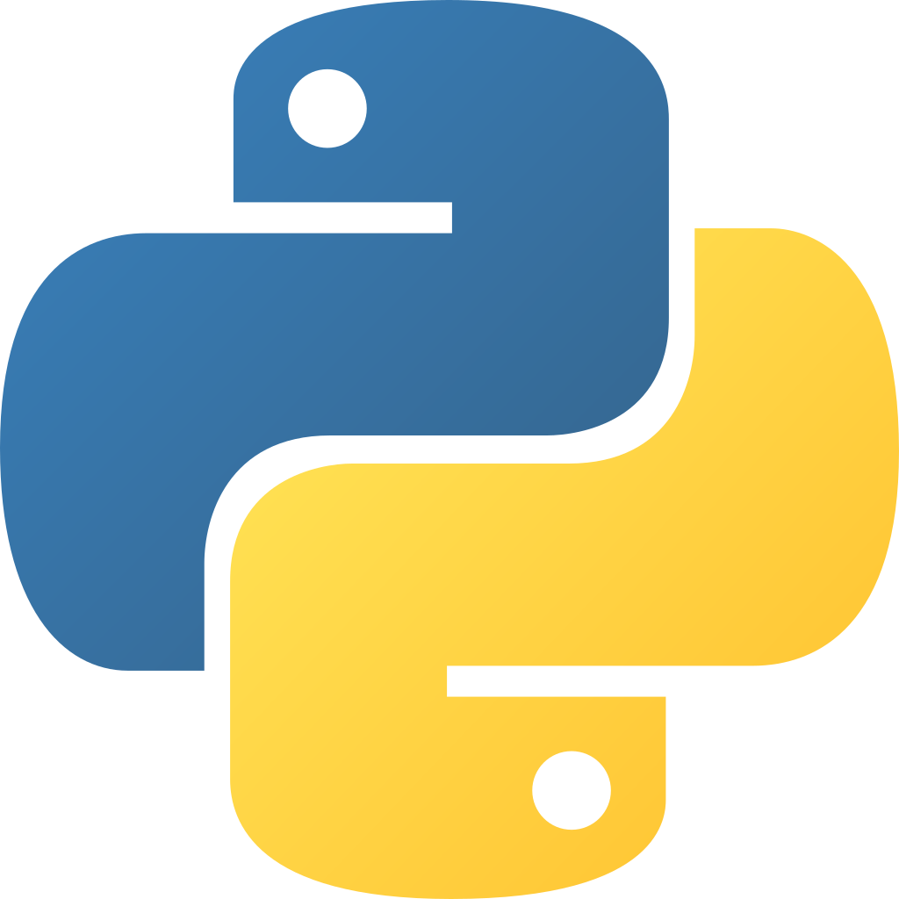
                </td>
                <td width="80px" align="center">
                <strong>Java</strong> 
                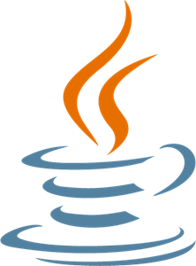
                </td>
                <td width="80px" align="center">
                <strong>C / C++</strong> 
                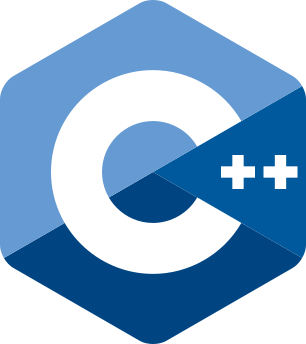
                </td>
                <td width="80px" align="center">
                <strong>C#</strong> 
                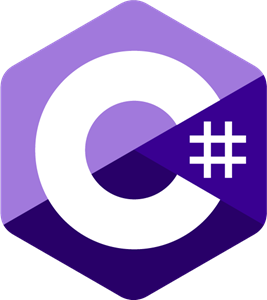
                </td>
        </tr>
        <tr valign="top">
                <td width="80px" align="center">
                <strong>Bash</strong> 
                
                </td>
                <td width="80px" align="center">
                <strong>SQL</strong> 
                
                </td>
                <td width="80px" align="center">
                <strong>JavaScript</strong> 
                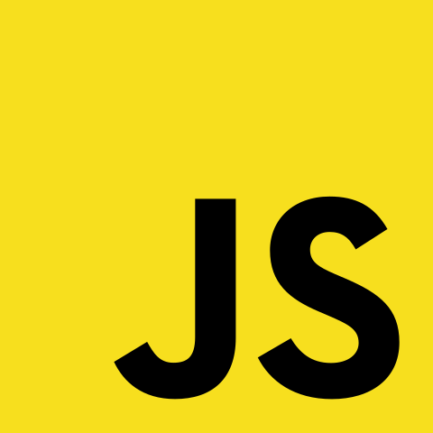
                </td>
                <td width="80px" align="center">
                <strong>Flux</strong> 
                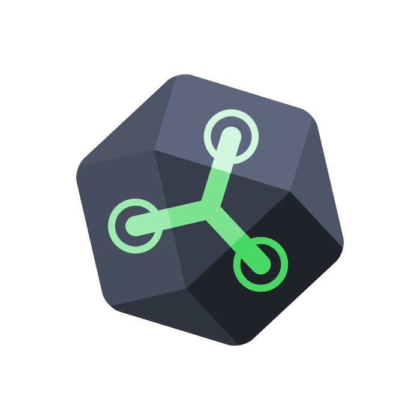
                </td>
        </tr>
    </table>
    
 

 

    
Technologies / Frameworks

     
    <table>
        <tr align="vtop">
            <td width="80px" align="center">
                <strong>Android Studio</strong> 
                
            </td>
            <td width="80px" align="center">
                <strong>QT</strong> 
                
            </td>
            <td width="80px" align="center">
                <strong>WxWidgets</strong> 
                
            </td>
        </tr>
        <tr>
            <td width="100px" align="center">
                <strong>InfluxDB</strong> 
                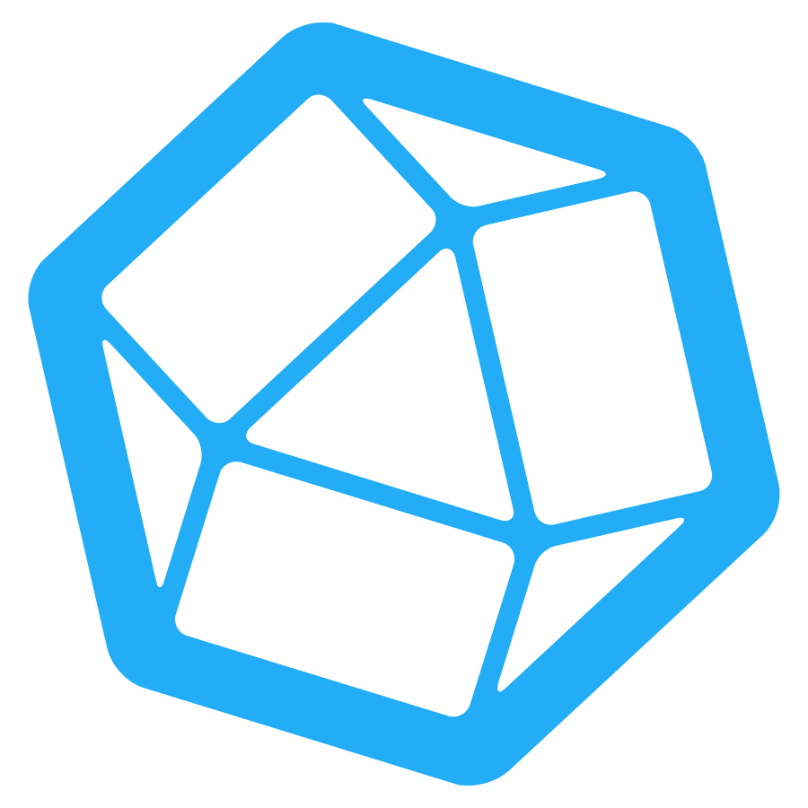
            </td>
            <td width="100px" align="center">
                <strong>NodeJS</strong> 
                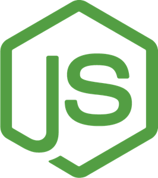
            </td>
            <td width="100px" align="center">
                <strong>Flask</strong> 
                
            </td>
        </tr>
    </table>
 

 

### Front-end web development:
 <table>
    <tr align="vtop">
        <td width="80px" align="center">
                <strong>HTML</strong> 
                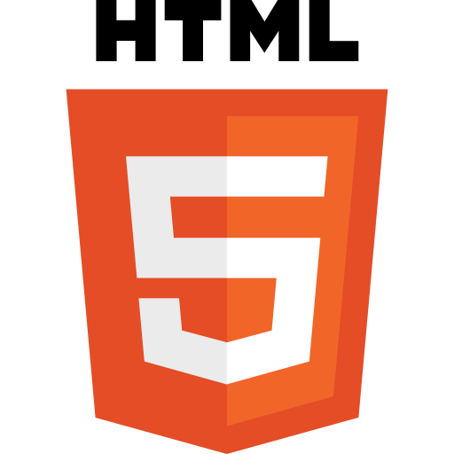
        </td>
        <td width="80px" align="center">
                <strong>CSS</strong> 
                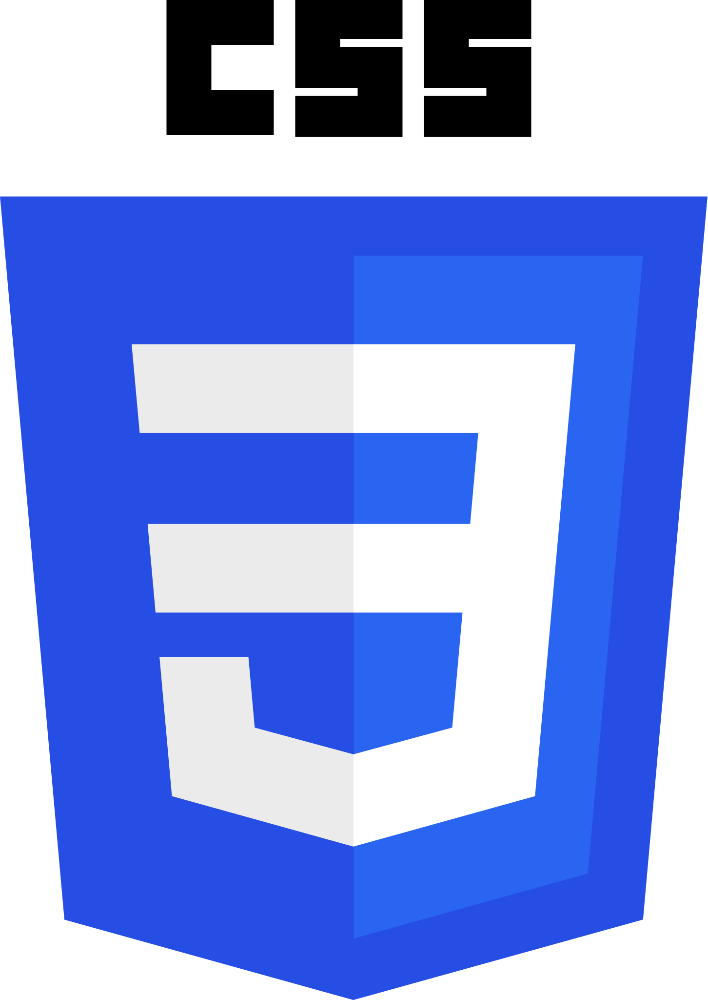
        </td>
    </tr>
 </table>
 

### Version control:
 - Git
 - Mercurial

### Text editors and IDEs I use:
 - Sublime Text
 - Visual Studio Cod
 - Emacs (mainly for document writing)
 - Android Studio
 - PyCharm
 - IntelliJ

 

## Stay in touch!
<table>
    <tr>
        <td align="center">
            
        </td>
        <td align="center">
            <a href="mailto:mymail@sbaltsas.xyz">mymail@sbaltsas.xyz</a>
        </td>
    </tr>
</table>
